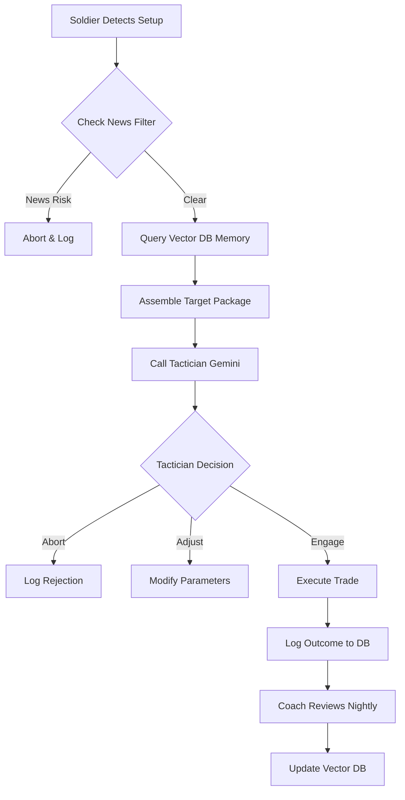

# MIDAS: Market Intelligence & Decision Analytics System

**System Architecture & Implementation Blueprint**
*Version 2.0 (Unified)*

---

## 1. Executive Summary

MIDAS upgrades a standard algorithmic trading bot into an Agentic AI system. It decouples **Execution** (speed) from **Intelligence** (reasoning) and introduces a **Memory Layer** to prevent repeated mistakes.

The core philosophy: **Your execution logic remains pure Python. Intelligence wraps around it.**

---

## 2. The Four Pillars (Roles)

The system is divided into four distinct roles to ensure separation of concerns:

### 1. The Soldier (Execution Engine)
*   **Identity:** Existing Python Script (`BosFvgStrategy.py`).
*   **Role:** The "Hands." Detects setups, manages orders, handles risk checks.
*   **Behavior:** Deterministic. It never waits for AI if safety is at risk.
*   **Key Upgrade:** Before entering, it gathers intel and asks *The Tactician* for permission.

### 2. The General (Situational Awareness)
*   **Identity:** Background Python Service (`analyst.py`).
*   **Role:** The "Eyes." Monitors the broader battlefield.
*   **Behavior:** Runs every 30 minutes. Checks Economic Calendar (News) and Volatility Regimes (ATR/VIX).
*   **Output:** Updates the `market_conditions` database table.

### 3. The Tactician (Live Decision Maker)
*   **Identity:** Gemini 1.5 Pro (API Call).
*   **Role:** The "Fast Brain." Makes the specific trade decision inside the loop.
*   **Behavior:** Receives a "Target Package" (Technicals + General's Report + Memory).
*   **Output:** `ENGAGE`, `ADJUST` (parameters), or `ABORT`.

### 4. The Coach (Learning & Memory)
*   **Identity:** Claude 3.5 Sonnet/Opus (Nightly Job).
*   **Role:** The "Slow Brain." Analyzes outcomes to update long-term memory.
*   **Behavior:** Runs post-market. Reviews execution, grades setups, and embeds lessons into the Vector Database (ChromaDB).

---

## 3. The Data Pipeline (The "Golden Triangle")

When The Soldier detects a setup, it does not call the AI immediately. It assembles a **Target Package** from three sources:

1.  **Technicals (Real-time):** The chart pattern (FVG, BOS, Price).
2.  **Context (From The General):** Is the environment safe?
3.  **Memory (From The Coach):** Have similar setups worked recently?

### The Data Flow



---

## 4. The Tactician's Interface

This is the specific data structure passed to Gemini (The Tactician) inside the trade loop.

### A. Input: The Target Package (Prompt)

The Soldier sends this JSON structure to The Tactician:

```json
{
  "role": "SYSTEM",
  "content": "You are The Tactician, an SMC execution expert.",
  "data": {
    "1_TECHNICALS": {
      "symbol": "MES",
      "time": "10:30 EST",
      "trend_bias_1h": "BULLISH",
      "pattern": "5m_FVG_UNMITIGATED",
      "price_action": {
        "current": 5850.25,
        "entry_zone_top": 5852.00,
        "entry_zone_bottom": 5848.00
      }
    },
    "2_BATTLEFIELD_CONDITIONS": {
      "source": "The General",
      "volatility_state": "EXTREME",
      "atr_percentile": 92,
      "news_status": "CLEAR",
      "next_event": "FOMC_MINUTES (120 mins)"
    },
    "3_INTELLIGENCE_REPORT": {
      "source": "Vector Memory",
      "similar_trades_found": 12,
      "win_rate_in_this_context": "41%",
      "common_failure_reason": "STOP_HUNT",
      "coach_warning": "In EXTREME volatility, standard entries fail. Deepen entry to 0.9 or SKIP."
    }
  }
}
```

### B. Output: The Order

The Tactician must respond with strictly formatted JSON:

```json
{
  "decision": "ADJUST", 
  "reasoning": "Technicals are valid, but battlefield conditions (EXTREME volatility) and Intelligence Report suggest high risk of stop run. Adjusting entry deeper.",
  "parameters": {
    "action": "BUY_LIMIT",
    "entry_price": 5848.50, 
    "stop_loss": 5840.00,
    "size_multiplier": 0.5
  }
}
```

---

## 5. Technical Architecture

### Hardware & Stack
*   **Server:** Mac Mini (M-Series, 16GB+ RAM)
*   **Power:** UPS Backup (Essential)
*   **Orchestration:** Docker Compose
*   **Database:** PostgreSQL + TimescaleDB (Time-series data)
*   **Vector Store:** ChromaDB (Local embeddings)

### Database Schema

#### 1. `market_conditions` (Managed by The General)
| Column | Type | Description |
| :--- | :--- | :--- |
| `timestamp` | DATETIME | Time of snapshot |
| `volatility` | VARCHAR | LOW, MEDIUM, HIGH, EXTREME |
| `news_risk` | BOOLEAN | True if within blackout window |
| `bias` | VARCHAR | LONG, SHORT, NEUTRAL (Macro bias) |

#### 2. `trade_signals` (Managed by Soldier & Coach)
| Column | Type | Description |
| :--- | :--- | :--- |
| `id` | UUID | Unique Trade ID |
| `input_package` | JSONB | The full data sent to Tactician |
| `ai_decision` | JSONB | The Tactician's response |
| `result_pnl` | FLOAT | Final R-Multiple (filled post-close) |
| `coach_grade` | INT | 0-100 Score (filled nightly) |
| `regime_tag` | VARCHAR | Context tag (e.g., "HIGH_VOL_CHOP") |

#### 3. `rejected_signals` (The Shadow Log)
*Stores trades the Tactician said "NO" to. Used by the Coach to verify if skipping was the right decision.*

---

## 6. Implementation Roadmap

### Phase 1: Infrastructure (The Vault)
1.  Install Docker on Mac Mini.
2.  Deploy **TimescaleDB** container.
3.  Modify `BosFvgStrategy.py` to log every detected signal to the DB (Passively).
4.  **Goal:** Build a dataset of potential trades.

### Phase 2: The General (The Eyes)
1.  Create `analyst.py`.
2.  Implement Scraper for Economic Calendar.
3.  Implement Volatility Logic (Pandas rolling ATR).
4.  Schedule to run every 30 mins via Cron.
5.  **Goal:** Bot is aware of News and Volatility.

### Phase 3: The Coach (The Memory)
1.  Deploy **ChromaDB** container.
2.  Create `coach.py`.
3.  Script the nightly review:
    *   Query `trade_signals` for closed trades.
    *   Send to Claude: "Analyze this execution."
    *   Embed result into ChromaDB.
4.  **Goal:** System builds a searchable history of "What works."

### Phase 4: The Tactician (The Brain)
1.  Update `BosFvgStrategy.py` to query ChromaDB + General DB.
2.  Construct the "Target Package."
3.  Send to Gemini API.
4.  Parse JSON response and execute logic (`ENGAGE` / `ADJUST` / `ABORT`).
5.  **Goal:** Fully closed Agentic Loop.

---

## 7. Example Scenarios

### Scenario A: The News Block
*   **Soldier:** Detects FVG.
*   **General:** `market_conditions` table shows `news_risk: TRUE` (CPI in 10 mins).
*   **Action:** Soldier keeps "Safety Mode" on. Trade is blocked locally. **Tactician is never even called** (Saves API costs).

### Scenario B: The Volatility Adjustment
*   **Soldier:** Detects FVG.
*   **General:** Volatility is `HIGH`.
*   **Memory:** "In HIGH vol, standard stops get hit 60% of time."
*   **Tactician:** Reads Memory. Returns `decision: ADJUST`. Sets Stop Loss 2 points wider and reduces position size.
*   **Result:** Price wicks down, misses original stop, hits wider stop, then rallies. **Trade Saved.**

### Scenario C: The "Smart" Skip
*   **Soldier:** Detects FVG.
*   **Memory:** "This specific setup (Counter-trend FVG) has a 15% win rate in current conditions."
*   **Tactician:** Returns `decision: ABORT`.
*   **Coach (Next Day):** Simulates the trade using historical data. Confirms it would have been a loss. Updates Memory: "Good decision to skip."
